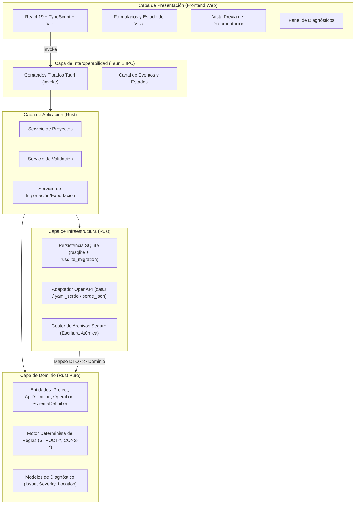

# Arquitectura del Sistema CAAD

**Proyecto:** CAAD (*Computer Assisted API Design*)  
**Tipo:** Aplicación Desktop Local-First  
**Versión de Arquitectura:** 1.0 (Definida en Hito 0)  
**Fecha:** Octubre 2026  

---

## 1. Visión y Principios Arquitectónicos

CAAD está concebido como un entorno de escritorio asistido para el diseño, validación y documentación de contratos de API HTTP REST antes de su codificación backend.

### Principios Fundamentales
1. **Local-First y Privacidad:** Todos los datos se almacenan localmente en SQLite. No se requiere conexión a internet, telemetría ni autenticación externa.
2. **Núcleo de Dominio Independiente:** La lógica de negocio, reglas de diseño y validaciones residen en Rust puro, sin acoplamiento a Tauri, React, bases de datos o bibliotecas externas de OpenAPI.
3. **Frontend Reactivo y Desacoplado:** React + TypeScript + Vite se utiliza para una experiencia de usuario fluida con formularios contextuales densos y navegación ágil, pero no duplica las reglas de negocio del dominio.
4. **Tratamiento de Entrada No Confiable:** Cualquier archivo JSON o YAML importado se considera potencialmente malicioso o malformado. Se prohíbe la resolución automática de referencias remotas (`$ref` a URLs externas o rutas de sistema de archivos no autorizadas).
5. **No Pérdida Silenciosa:** Todo elemento que no pueda ser representado por el subconjunto de OpenAPI soportado por CAAD debe ser explícitamente advertido al usuario antes de sobrescribir o descartar datos.

---

## 2. Diagrama de Capas y Flujo de Información

---

## 3. Descripción Detallada de Capas

### 3.1 Capa de Presentación (Frontend)
- **Tecnologías:** React, TypeScript, Vite, Bun.
- **Responsabilidades:**
  - Renderizar paneles de navegación, editores contextuales, listas de esquemas y endpoints.
  - Gestionar estado transitorio de UI (selección activa, pestañas abiertas, borradores no confirmados).
  - Enviar comandos tipados a Tauri.
  - Mostrar el panel de diagnósticos con enlaces directos al campo o elemento afectado.
  - **Restricción:** El frontend NO realiza validaciones de consistencia de negocio ni interactúa directamente con el sistema de archivos ni SQLite.

### 3.2 Capa de Comandos IPC (Tauri 2 Bridge)
- **Tecnologías:** Tauri 2 (`tauri` crate).
- **Responsabilidades:**
  - Exponer funciones IPC explícitas y estrictamente tipadas mediante Serde.
  - Validar argumentos de entrada a nivel de interfaz de transporte.
  - Traducir errores internos de Rust en respuestas estructuradas serializables (`Result<T, AppErrorDto>`).
  - **Restricción:** No exponer primitivas de acceso libre al sistema de archivos ni ejecución de subprocesos arbitrarios.

### 3.3 Capa de Aplicación
- **Responsabilidades:**
  - Orquestar los casos de uso: creación/apertura de proyectos, persistencia periódica debounced, importación con reporte de diferencias y exportación atómica.
  - Gestionar límites transaccionales de almacenamiento.
  - Coordinar la ejecución del validador tras confirmaciones de edición.

### 3.4 Capa de Dominio (Rust Puro)
- **Responsabilidades:**
  - Modelar conceptos centrales: `Project`, `ApiDefinition`, `SchemaDefinition`, `Operation`, `Parameter`, `RequestBody`, `Response`.
  - Aplicar invariantes (unicidad de rutas/métodos, referencias de parámetros en ruta, etc.).
  - Motor de validación determinista que evalúa el árbol del contrato y produce `DesignIssue` con código de regla (`STRUCT-001`, `CONS-001`, etc.), severidad, ubicación y sugerencia.
  - **Aislamiento:** Este módulo no incluye dependencias de `tauri`, `rusqlite`, ni de `oas3`.

### 3.5 Capa de Infraestructura
- **Responsabilidades:**
  - **Almacenamiento Local:** Base de datos SQLite gestionada con `rusqlite` (versión embebida/`bundled`) y versionado de esquemas mediante `rusqlite_migration` utilizando `PRAGMA user_version`. Almacena el proyecto como documento JSON estructurado versionado (`document_schema_version`).
  - **Adaptador OpenAPI:** Conversión bidireccional entre el modelo de dominio interno y los DTOs de OpenAPI 3.1.x mediante `oas3` y serialización YAML/JSON con `yaml_serde` o `serde-saphyr` y `serde_json`.
  - **Entrada/Salida Segura:** Escritura de archivos con reemplazo atómico para evitar archivos corruptos ante fallos de energía o caídas del sistema.

---

## 4. Estrategia OpenAPI 3.1.x e Interoperabilidad

### 4.1 Aislamiento del Dominio vs DTO de Intercambio
OpenAPI 3.1 introdujo cambios estructurales profundos (alineación plena con JSON Schema Draft 2020-12, permitiendo tipos nulos como `type: ["string", "null"]` y reemplazando `nullable: true`).
Para proteger a CAAD de acoplamientos rígidos con esquemas externos:
1. El modelo interno de CAAD posee su propio AST de esquemas y operaciones.
2. La biblioteca OpenAPI (`oas3`) se utiliza exclusivamente en la capa de infraestructura como DTO de importación/exportación.
3. Se implementan convertidores explícitos:
   - `oas3::Spec -> DomainApiDefinition` (con informe de elementos no soportados).
   - `DomainApiDefinition -> oas3::Spec` (para generación limpia de JSON/YAML).

### 4.2 Política de Referencias Externas
- Solo se resuelven referencias internas locales (`#/components/schemas/...`).
- No se descargan `$ref` HTTP/HTTPS ni se navega por rutas de disco externas sin consentimiento explícito del usuario. Las referencias externas detectadas se registran como advertencias informativas en el diagnóstico.

---

## 5. Decisiones de Persistencia

- **Esquema SQLite:** Tabla `projects` con columnas:
  - `id TEXT PRIMARY KEY` (UUID v4)
  - `name TEXT NOT NULL`
  - `description TEXT`
  - `document_schema_version INTEGER NOT NULL`
  - `document_json TEXT NOT NULL`
  - `created_at TEXT NOT NULL` (ISO-8601 UTC)
  - `updated_at TEXT NOT NULL` (ISO-8601 UTC)
- **Modo WAL:** Activación de `PRAGMA journal_mode = WAL` para permitir lecturas y escrituras eficientes y seguras.
- **Guardado Automático:** Lógica debounced en el frontend (ej. 1000ms tras último cambio o al perder foco) que invoca `save_project` en Rust, reportando estados `Guardando...`, `Guardado` o `Error al guardar`.
